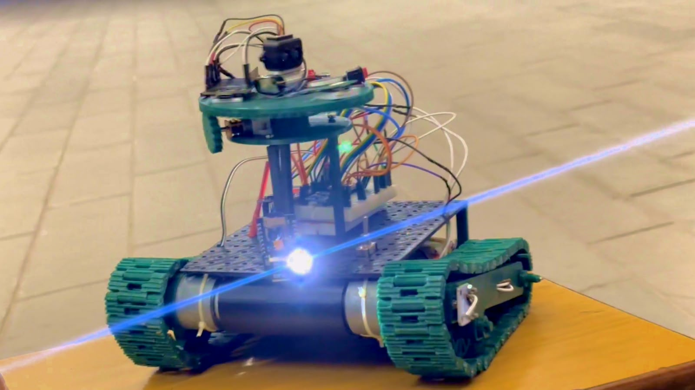
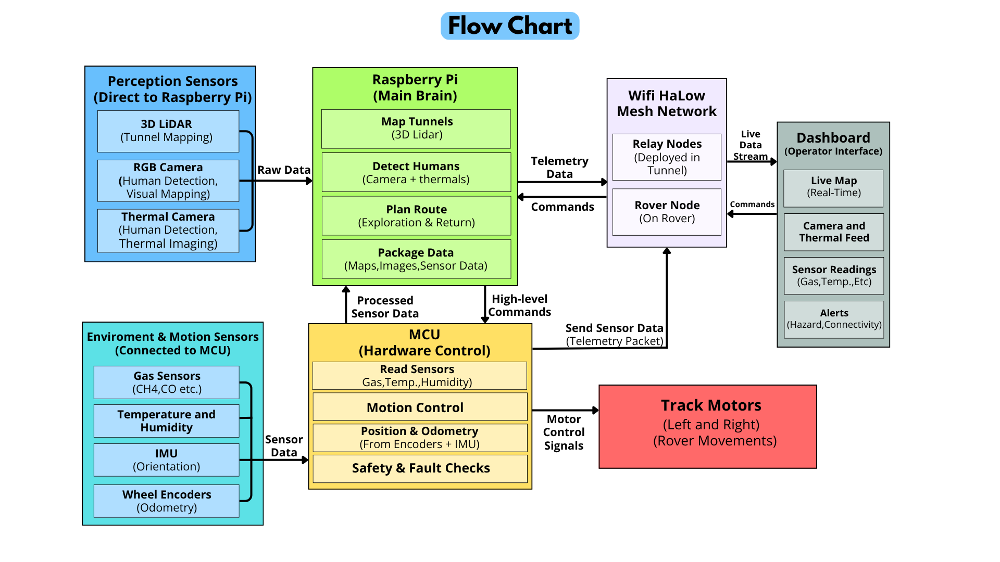
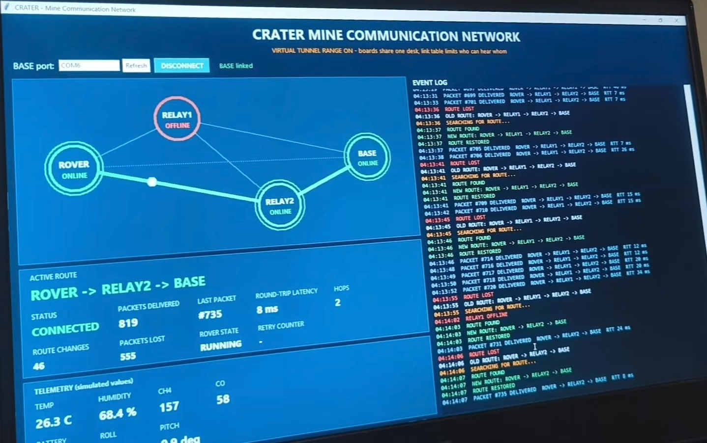
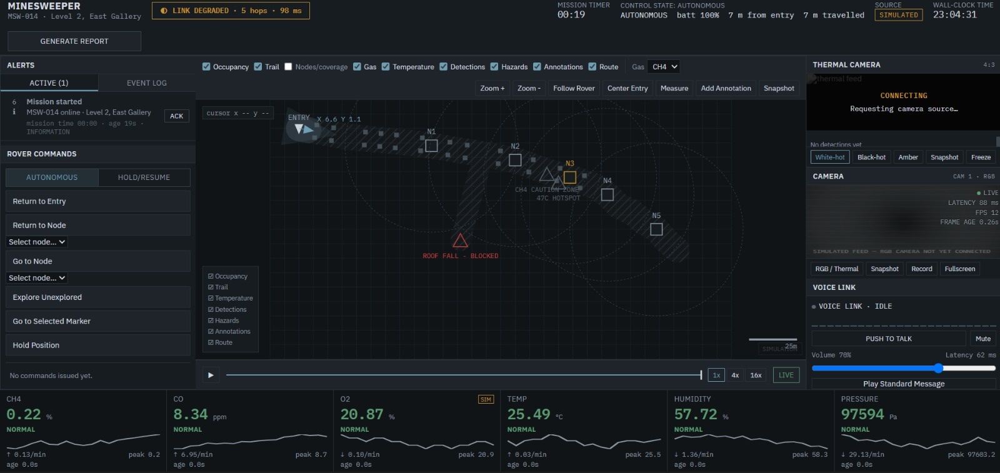

# CRATER
**Compact Rover for Autonomous Tunnel Exploration & Rescue**

*Send a robot in first, not people.*

[](https://youtu.be/ypSJ9OmCvYg?si=MKHVfJJ0d8UbY9vU)

<p align="center">
  
</p>

---

## Why we built this

When a mine emergency hits, rescue teams walk in blind: toxic gas, collapsed tunnels, no light, no comms. Both trapped workers and rescuers are at risk.

CRATER is a tracked rover that goes in first. It maps the tunnel in 3D, senses gas and temperature, looks for people with a thermal camera, and drops wireless relay nodes behind it so the link back to the surface doesn't die. Rescuers get a live picture of what's ahead before anyone enters.

Built by **Team Treadmill** for Smart India Hackathon 2026.
**PS 26039** · AI-Powered Underground Mine Safety, Monitoring and Rescue System · Smart Automation · Hardware

---

## What it does

| | |
|---|---|
| 🗺️ **LiDAR mapping** | Live 3D point cloud and 2D map of the tunnel |
| 🔥 **Thermal + RGB vision** | Spots possible survivors in total darkness (YOLOv8 + posture CNN + ByteTrack) |
| ☣️ **Gas & climate sensing** | CH4, CO, temperature, humidity with alerts on the dashboard |
| 📡 **Relay mesh** | Rover drops Wi-Fi HaLow relay nodes to extend range underground |
| 🖥️ **Live dashboard** | Map, camera, thermal feed, sensor readings and alerts in one screen |
| 🚜 **Tank tracks** | 3D-printed tracks for rubble, mud and tight spaces |

---

## How it works

<p align="center">
  
</p>

- **Raspberry Pi**: the brain. Runs mapping, human detection and route planning on board, no internet needed.
- **Microcontroller (ESP32)**: motor control, gas/temp/humidity sensors, IMU, wheel encoders, safety checks.
- **Wi-Fi HaLow mesh (802.11ah, sub-GHz)**: carries telemetry up and commands down through the relay nodes.
- **Dashboard**: the operator's view on the surface.

Odometry comes from wheel encoders + IMU, fused with LiDAR for mapping.

---

## Mesh network

<p align="center">
  
</p>

The rover carries relay nodes in a magazine on its back and deploys them as it goes deeper. Each node extends the link, so telemetry can hop back to the surface gateway instead of relying on one radio path.

---

## Mapping

<p align="center">
  
  
</p>

*Left: Point cloud from the rover's LiDAR. Right: the 2D map generated from it.*

---

## Dashboard

<p align="center">
  
</p>

Live map, camera and thermal feeds, gas/temperature readings, connectivity status and hazard alerts.

---

## Hardware

| Part | Job |
|---|---|
| Raspberry Pi | Mapping, vision, navigation |
| ESP32 | Low-level control and sensors |
| 3D LiDAR | Tunnel mapping |
| RGB + thermal camera | Visual inspection, human detection |
| Gas, temp, humidity sensors | Environmental monitoring |
| IMU + wheel encoders | Motion estimation |
| Wi-Fi HaLow radios | Rover-to-surface link |
| Tracked 3D-printed chassis | Rough-terrain drive |

---

## Run it

```bash
git clone https://github.com/Surianubhav/CRATER_Compact_Rover_for_Autonomous_Tunnel_Exploration_and_Rescue.git
cd CRATER_Compact_Rover_for_Autonomous_Tunnel_Exploration_and_Rescue
```

Each subsystem (firmware, mapping, perception, dashboard) has its own setup in its folder.

---

## Status & safety

CRATER is a working hardware prototype built for a hackathon. It has **not** been validated in an operational mine, and it is not a certified or intrinsically safe instrument. Its readings must never be the only basis for declaring an area safe to enter.

**Next up:** better localization on slippery terrain, tested autonomous exploration, real-tunnel range testing for HaLow, and calibrated gas sensing.

---

## Team Treadmill

<p align="center">
  
</p>

| Name | Role | Links |
|---|---|---|
| Anubhav Suri | CAD, Electronics and Mapping Systems | https://www.linkedin.com/in/anubhav-suri-79a084321 |
| Abhinav Saini | Embedded Control System | https://www.linkedin.com/in/abhinav-saini-a0b118313 |
| Arsh Handa | Electronics Sensor Fusion | https://www.linkedin.com/in/arsh-handa-08422331a |
| Aarush Thakur | Communication and Documentation | https://www.linkedin.com/in/aarush-thakur-profile19022006 |
| Manjot Kaur | Software and AI | https://www.linkedin.com/in/manjot-kaur-124541304 |
| Jayostu Chanda | Mechanical CAD Design | https://www.linkedin.com/in/jayostu-chanda-028a15247 |
